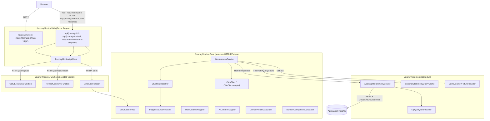

# Architecture

## Goals

1. Behavioral parity with the original Node.js app (`reliable-portal`) for
   `/api/journeys` and `/api/clubs`.
2. Business logic (session/journey reconstruction, correlation, classification) must be
   testable with plain unit tests, with zero dependency on Azure, HTTP, EF Core, or
   Razor - so a future telemetry source (Fabric) or a future consumer (an agent, a new
   dashboard) can reuse it without rewriting it.
3. Azure SQL holds durable journey snapshots (per-vertical hotel/car/cruise/air schemas),
   not a short-lived KQL result cache. Swapping Application Insights for Microsoft Fabric
   must not touch journey-reconstruction logic.
4. Razor Pages stay thin. Azure Functions stay thin. Business logic lives in Core.

## Components



### Dependency direction (enforced by project references)

```
Web  -->  (HTTP)  -->  Functions
Functions  -->  Core
Infrastructure  -->  Core   (implements Core's interfaces)
Core  -->  (nothing Azure/HTTP/EF/Razor)
```

`JourneyMonitor.Core` has **zero** package references beyond the BCL. It defines the
interfaces (`ITelemetrySource`, `ITelemetryQueryCache`, `IDemoJourneyFixtureProvider`,
`IKqlQueryTextProvider`) that `JourneyMonitor.Infrastructure` implements. This is what
lets `JourneyMonitor.Tests` exercise `GetJourneysService`, `HotelJourneyMapper`,
`DomainHealthCalculator`, etc. with in-memory fakes and real fixture files - no Azure
credentials, no HTTP server, no database.

## Why `/api/journeys` and `/api/clubs` return raw rows, not mapped journeys

This is the single most important design decision in this migration, and it exists
only because of how the **original** app is built - not because it's the ideal shape
for a brand-new API.

In the original Node app, the server (`server.js` + `query-appinsights.js`) only runs
the KQL query and returns the **raw Kusto rows** as JSON. The browser then maps those
rows into journey objects **client-side**, via `map-v6.js` (Hotels/Cruises/Cars) or
`map-air.js` (Air), which `app.js` calls directly on `payload.rows`. Domain health and
domain comparison (`domain-health.js`, `domain-comparison.js`) then run **again in the
browser** against that already-mapped, in-memory journey state.

Because `JourneyMonitor.Web/wwwroot` serves that exact same unmodified JavaScript
(byte-for-byte, for UI parity), the live journey query service **must** also return raw
rows. If the .NET backend mapped rows into `CustomerJourney` DTOs and
still served the original `map-v6.js`, the browser would map already-mapped data a
second time and silently corrupt the UI (wrong field names, double-derived status
labels, etc.).

`HotelJourneyMapper`, `AirJourneyMapper`, `DomainHealthCalculator`, and
`DomainComparisonCalculator` were still ported to C# and are fully characterization-
tested (`tests/JourneyMonitor.Tests/Mapping`, `tests/JourneyMonitor.Tests/Analytics`).
They are **intentionally not wired into the live API path** yet. They exist as the
tested foundation for a deliberate, separate follow-up: moving mapping server-side
behind an explicit DTO contract (`CustomerJourneyDto`, etc.), retiring the original
client-side JS mappers, and thinning the browser down to a pure rendering layer. Doing
that today, as a side effect of the parity migration, would have made it impossible to
tell whether a UI discrepancy came from a genuine behavior change or from the parity
port itself - so it was deferred.

See `src/JourneyMonitor.Core/Domain/TelemetryModels.cs` for the code-level note on this
(`TelemetryJourneyRow` doc comment) and `MIGRATION.md` for the JS→.NET component map.

## `ITelemetrySource` vs `ITelemetryQueryCache`

Two distinct abstractions, deliberately not merged into one "repository":

- **`ITelemetrySource`** - *where telemetry originally comes from*. Today:
  `AppInsightsTelemetrySource`, a REST client for the Application Insights Query API
  (`api.applicationinsights.io/v1/apps/{appId}/query`), authenticated via
  `Azure.Identity.DefaultAzureCredential`. Tomorrow: `FabricTelemetrySource`, without
  touching `GetJourneysService`, `ClubHostResolver`, or any mapper/calculator.
- **`ITelemetryQueryCache`** - *where we keep our own copy of recent query results*, so
  the UI doesn't repeatedly re-run expensive KQL. Today: `InMemoryTelemetryQueryCache`
  (same 90s TTL and cache-key shape as the original app's in-process `Map` cache:
  domain/win/club/environment/rowCap). Durable snapshots live on `IJourneyStore`, not
  in this cache.

`GetJourneysService` depends on both interfaces and never talks to Application
Insights or SQL directly - it orchestrates: check cache → query source on miss →
populate cache → fall back to snapshot/demo fixture on failure, mirroring
`handleJourneysApi` in the original `server.js`.

## Browser request flow: journey database reads and refresh

```
Browser
  -> GET /api/journeys/db?domain=hotels&win=2h&club=15639   (JourneyMonitor.Web)
  -> Proxy endpoint forwards via JourneyMonitorApiClient
  -> GetDbJourneysFunction (HTTP trigger)                  (JourneyMonitor.Functions)
  -> GetDbJourneysService reads filtered rows from SQL
  <- JourneysResult { source, domain, clubId, rowCount, rows: TelemetryJourneyRow[] }

Browser
  -> POST /api/journeys/refresh?domain=hotels&win=2h        (JourneyMonitor.Web)
  -> Proxy endpoint forwards via JourneyMonitorApiClient
  -> RefreshJourneysFunction (HTTP trigger)                (JourneyMonitor.Functions)
  -> SyncJourneysService queries App Insights and stores a snapshot
  -> Browser re-reads GET /api/journeys/db
```

## Journey store sync flow

```
Timer triggers (JourneyMonitor.Functions), independent schedules
  -> SyncHotelJourneys   every 5 minutes (platform_reliability_cron_setting)
  -> SyncCruiseJourneys  every 5 minutes (platform_reliability_cron_setting)
  -> SyncJourneysService.SyncDomainAsync for that vertical only
       - one journey KQL for the vertical, top 200 per club, then UpsertAsync per club
       - one KQL per dashboard chart (hotels grouped by host, cruises by partner)
       - ingests that domain's exceptions when the incident schema is present

Browser
  -> POST /api/journeys/refresh (JourneyMonitor.Web)
  -> RefreshJourneysFunction (HTTP trigger)
  -> SyncJourneysService (JourneyMonitor.Core)
  -> Browser re-reads GET /api/journeys/db
```

`GET /api/clubs` follows the same shape via `GetClubsService`/`GetClubsFunction`, but its
club list comes from the platform database's `brand.Information` table (`IBrandCatalog` ->
`SqlBrandCatalog`, seeded by `Sql/CreateBrandTables.sql`) rather than App Insights discovery
KQL. Hotels/Cars options are keyed by `ClubId` with `Url` as host; Air/Cruises collapse rows to
distinct `IcePartnerId`. `ClubHostResolver` also reads the brand `Url` (production only) before
falling back to the discovery KQL, so a club picked from the dropdown queries the right host.
The built-in demo club list is the fallback when no connection string is configured.

## Adding a new Azure Function

1. Add a use-case interface + implementation in `JourneyMonitor.Core.UseCases` if the
   operation doesn't already exist (e.g. `IAnalyzeLatencyService`). Keep it a plain
   class with constructor-injected interfaces - no Azure/HTTP types in the signature.
2. Add a thin `[Function("...")]` class in `JourneyMonitor.Functions/Functions/` that:
   parses the request, calls the use case, maps the result to an `HttpResponseData`.
   No business logic in the function method body.
3. Register the use case in `JourneyMonitor.Functions/Program.cs` (or in
   `Infrastructure/DependencyInjection/ServiceCollectionExtensions.cs` if it belongs
   there instead) via standard DI.
4. If the UI needs it, add a method to `IJourneyMonitorApiClient` and a proxy endpoint
   in `JourneyMonitor.Web/Program.cs`.

## Adding a new journey analyzer / mapper

Add it under `JourneyMonitor.Core` (e.g. `Analytics/`, `Mapping/`), taking only
`Core.Domain` models as input - no `TelemetryJourneyRow`/Infrastructure types unless
it's explicitly a row-mapping concern like `HotelJourneyMapper`. Write a
characterization test alongside it in `tests/JourneyMonitor.Tests` before wiring it
into any Function, following the pattern in `Mapping/HotelJourneyMapperTests.cs`.

## Replacing Application Insights with Microsoft Fabric

1. Implement `ITelemetrySource` as `FabricTelemetrySource` in
   `JourneyMonitor.Infrastructure` (or a new `JourneyMonitor.Infrastructure.Fabric`
   project, if the dependency footprint is large enough to warrant separating it).
2. Register it in place of `AppInsightsTelemetrySource` in DI
   (`ServiceCollectionExtensions`/`Program.cs`) - one line change.
3. `GetJourneysService`, `ClubHostResolver`, every mapper/calculator, and every
   characterization test in `JourneyMonitor.Tests` require **zero** changes, because
   they depend only on `ITelemetrySource`/`ITelemetryQueryCache`, not on Application
   Insights types.

## Security

- **User -> Web**: Microsoft Entra ID SSO via `Microsoft.Identity.Web` (OpenID
  Connect). All pages require authentication by default once `AzureAd:TenantId` is
  configured; there are no local username/password tables.
- **Web -> Functions**: intended to use a Managed Identity service-to-service token
  (the Web App's system-assigned identity, scoped to invoke the Function App) since
  individual user identity isn't required inside Functions for this workload. The
  current `JourneyMonitorApiClient` does not yet attach a token (local dev talks to an
  unauthenticated `func start` host) - adding the token acquisition is a deployment-time
  follow-up, tracked in MIGRATION.md's "Known gaps" section.
- **Functions -> Azure SQL / Application Insights**: Managed Identity where the SDK
  supports it (`DefaultAzureCredential` already covers Application Insights query
  auth locally via `az login` and in Azure via Managed Identity with no code change).
- No secrets in source control. Local development uses `local.settings.json`
  (local.settings.json holds Application Insights application ids for local clone; no instrumentation keys).

## Observability

Application Insights/OpenTelemetry is wired into both `JourneyMonitor.Web` (ASP.NET
Core default instrumentation) and `JourneyMonitor.Functions`
(`ConfigureFunctionsApplicationInsights()` in `Program.cs`), giving distributed tracing
across the Web -> Functions hop out of the box via correlation headers. Cache
freshness/source metadata (which source served a result, when it was last
synchronized) is carried on `JourneysResult`/`ClubsResult.Source` today; a dedicated
`/api/telemetry/health` endpoint exposing sync checkpoints is a natural next Function
to add once a real ingestion/sync job exists (see MIGRATION.md known gaps).
