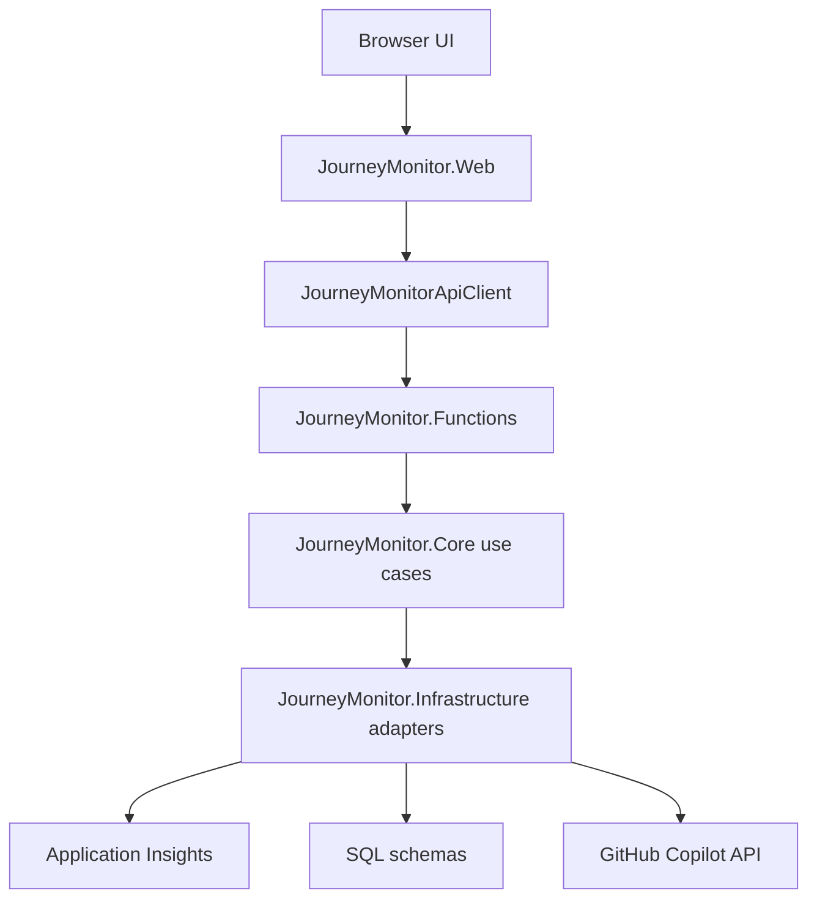

# JourneyMonitor architecture

JourneyMonitor is organized as a thin-host, Core-first .NET solution. `JourneyMonitor.Web` serves the portal UI and proxies API calls; `JourneyMonitor.Functions` hosts HTTP and timer Functions; `JourneyMonitor.Core` owns business behavior; and `JourneyMonitor.Infrastructure` implements telemetry, SQL, KQL, caching, demo, and LLM adapters.

The architecture page in `Portal/ARCHITECTURE.md` is still the canonical source for the detailed parity rationale. This wiki page summarizes the current runtime shape and links the operational flows to [Data flows](data-flows.md) and [Monitoring agents](monitoring-agents.md).

## Component model

This diagram shows the request and dependency direction across the four projects and external systems.

Project references enforce the important boundary: Core does not depend on Azure Functions, HTTP, Razor Pages, EF, or Application Insights SDK types. Functions compose Core services and Infrastructure implementations in `JourneyMonitor.Functions/Program.cs`, while Web calls Functions over HTTP through `JourneyMonitorApiClient` rather than hosting business logic in-process.

## Web host and API proxy

`JourneyMonitor.Web/Program.cs` serves static files from `wwwroot`, disables aggressive caching for static assets, wires optional Microsoft Entra ID authentication, and maps thin Minimal API proxy routes. Representative proxy routes include:

- `/api/journeys/db` and `/api/journeys/refresh` for stored journey reads and refreshes.
- `/api/exceptions`, `/api/overview`, and `/api/analytics/metrics` for SQL-backed operational views.
- `/api/monkeys`, `/api/findings`, and `/api/findings/{id}/doctor-report` for the Simian Army experience.
- `/api/settings/latency` and `/api/settings/llm-client` for runtime monitoring-agent settings.

Those Web endpoints dispatch through `JourneyMonitorApiClient`, which centralizes outbound paths, cancellation, extra headers for internal/setting secrets, and the future Managed Identity token attachment point.

## Functions host

`JourneyMonitor.Functions` is the public API and timer host for the product. `Program.cs` registers Core use cases, SQL journey store support, monitoring services, and Data Protection for encrypting the Doctor Monkey token at rest. Functions are intentionally thin: they parse request values, call a use case or repository abstraction, and serialize JSON responses.

Important Function groups:

- Journey APIs and timers: `GetDbJourneysFunction`, `RefreshJourneysFunction`, `GetStoredJourneysFunction`, and `SyncJourneysFunction` feed the [Data flows](data-flows.md) page.
- Operational APIs: `GetIncidentsFunction`, `GetOverviewFunction`, and `GetDashboardMetricsFunction` read stored SQL projections.
- Monitoring agents and settings: `LatencySpikeMonkeyFunction`, `GetMonkeysFunction`, `GetFindingsFunction`, `UpsertLatencySpikeSettingFunction`, and `UpsertLlmClientSettingFunction` are detailed in [Monitoring agents](monitoring-agents.md).

## Infrastructure adapters

`JourneyMonitor.Infrastructure` implements Core interfaces with concrete systems:

- `AppInsightsTelemetrySource` queries the Application Insights Query REST API with `DefaultAzureCredential`.
- `KqlQueryTextProvider` loads embedded KQL files.
- `InMemoryTelemetryQueryCache` preserves the original Node app's short-lived query-cache behavior for live query paths.
- `SqlJourneyStore`, dashboard, incident, overview, brand, and monitoring SQL repositories use Dapper/stored procedures against the configured journey store database.
- `GitHubCopilotLlmClient` supplies Doctor Monkey chat and embeddings when a `gho_` token is configured through settings or environment options.

## Authentication and sensitive routes

Web authentication is optional locally: if `AzureAd:TenantId` is empty, `JourneyMonitor.Web` skips Entra wiring so a fresh clone can run. When Entra is configured, the fallback policy requires an authenticated session for pages and non-anonymous routes.

Functions currently use `AuthorizationLevel.Anonymous`, so sensitive behaviors add additional guards:

- Settings writes require `X-Settings-Write-Secret` and fail closed when `Monitoring:SettingsWriteSecret` is absent or mismatched.
- Full Doctor report detail and LLM model probing require `X-Internal-Api-Secret`, because those endpoints expose prompt/raw response data or make outbound calls with caller-supplied credentials.
- Web Settings writes also validate antiforgery tokens when Entra is configured.

Before a production Azure deployment, the Web-to-Functions path should attach a Managed Identity service-to-service token at the `JourneyMonitorApiClient` extension point noted in source and existing architecture docs.

## Why raw journey rows still matter

The migration intentionally preserves the original browser-side mapping path for customer journeys. Application Insights or SQL snapshot rows are returned in the raw Kusto-shaped `TelemetryJourneyRow` envelope, and `wwwroot/map-v6.js` or `map-air.js` maps rows client-side. C# mappers and calculators exist in Core with tests, but the live UI path still avoids double-mapping so parity bugs are easier to isolate.

This raw-row contract links the architecture directly to [Data flows](data-flows.md): SQL stored procedures and `KqlRowAssembler` reconstruct the same row shape that the browser and Core mappers expect.
