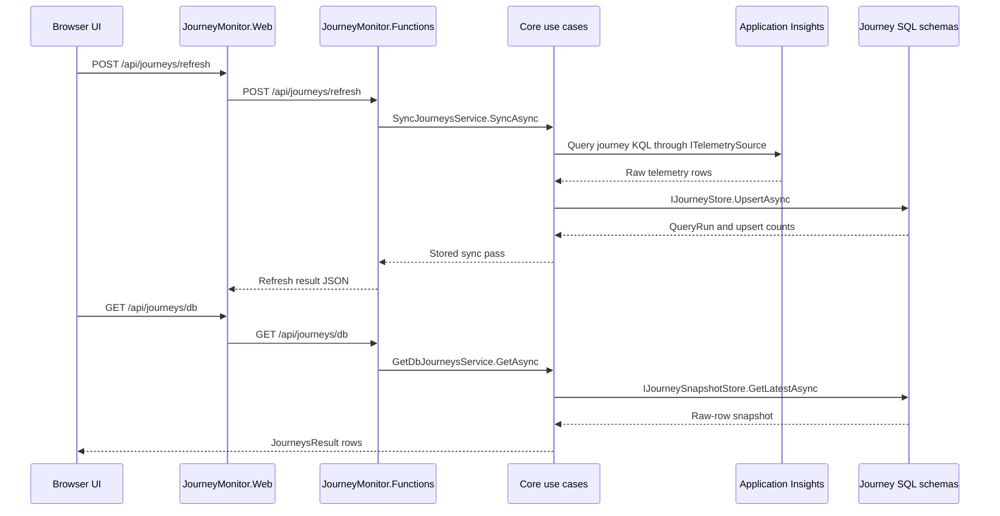
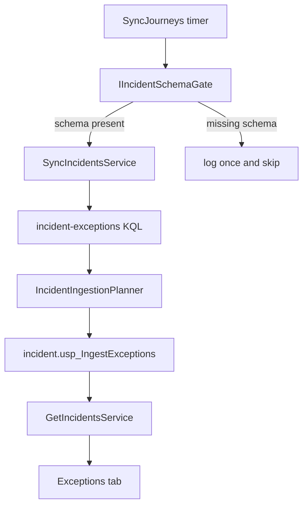

# JourneyMonitor data flows

JourneyMonitor's main operational flows start in Application Insights, normalize or group telemetry in Core use cases, and persist SQL projections for the portal. These flows are exposed through the component boundaries described in [Architecture overview](architecture.md), and the stored journey snapshot also feeds the SQL detector in [Monitoring agents](monitoring-agents.md).

## Journey snapshot sync and read path

`SyncJourneysFunction` runs on `platform_reliability_cron_setting`, while `RefreshJourneysFunction` lets the UI trigger the same sync behavior for a selected domain/window/environment/club. Both use `SyncJourneysService`, which reuses `GetJourneysService` so KQL injection, club/host resolution, telemetry querying, cache bypass, and row shape stay aligned with the live query path.

This sequence shows how a UI refresh writes a SQL snapshot, then the browser re-reads the latest snapshot through `/api/journeys/db`.

The SQL schemas are per vertical (`hotel`, `car`, `cruise`, `air`) and preserve raw journey JSON while shredding steps and calls into normalized tables. `SqlJourneyStore` maps plural portal domains to those schemas and calls `[schema].usp_IngestKqlRows` for writes and `[schema].usp_GetLatestJourneys` for reads. `KqlRowAssembler` rebuilds `TelemetryJourneyRow` records so the browser can continue using the original `map-v6.js` and `map-air.js` mapping code.

`JourneySyncOptions` controls timer defaults. Current source defaults enumerate `hotels,cruises`, with Air/Cars supported by schemas and request-time paths but dependent on configuration and valid Application Insights sources.

## Dashboard metrics and overview KPIs

`SyncJourneysService` also invokes `SyncDashboardMetricsService` per domain. That service uses dashboard-specific KQL resources through `KqlQueryTextProvider`, injects window/club/host/partner filters through `ClubFilter`, and stores time-binned points in `dashboard.MetricPoint` via `IDashboardMetricStore`.

`GetDashboardMetricsService` reads `dashboard.MetricPoint` for `/api/analytics/metrics`. An omitted or `all` domain aggregates points across the known portal domains.

The Executive Overview path is separate: `GetOverviewService` reads counts through `IOverviewReader` and composes seven KPI tiles with `OverviewComposer`. Availability is based on the last 24 hours for Hotels and Cruises, while the other filters follow the domain, club, environment, time window, and id/search values supplied by the request.

## Incident ingestion and Exceptions tab

Exception management uses a shared `incident` schema. `SyncJourneysFunction` runs incident ingestion after journey/dashboard sync, but only when `IIncidentSchemaGate` confirms `incident.usp_IngestExceptions` is provisioned. Missing incident schema logs a warning and does not fail the journey timer.

This flow shows how exceptions are grouped and stored only when the incident schema exists.

`SyncIncidentsService` queries exception telemetry using `incident-exceptions.txt`. Hotels and Cars share one Application Insights app, so the service queries the hotel app once and splits rows with `IncidentIngestionPlanner.IsCarException`; Cruises and Air use their own app configuration. `IncidentIngestionPlanner` drops browser noise, requires a club and item id, deduplicates batch item ids, groups by `Domain|ClubId|Environment|ExceptionType|Operation`, and computes severity from occurrence counts.

`GetIncidentsService` reads the incident store for `/api/exceptions`, resolves club display names through `IBrandCatalog` when the brand catalog is configured, and returns the shape consumed by the legacy Exceptions tab.

## SQL areas at a glance

| SQL area | Main source files | Runtime role |
|---|---|---|
| `hotel`, `car`, `cruise`, `air` schemas | `Infrastructure/Sql/*/Create*Schema.sql`, `SqlJourneyStore.cs` | Durable current journey snapshots and raw-row reconstruction. |
| `dashboard.MetricPoint` | `Sql/dashboard/CreateDashboardMetrics.sql`, `SqlDashboardMetricStore.cs` | Time-binned chart points for Analytics. |
| `incident.*` | `Sql/incident/CreateIncidentSchema.sql`, `SqlIncidentStore.cs`, `SqlIncidentReader.cs` | Grouped exception incidents and recent occurrences. |
| `monitoring.*` | Monitoring SQL scripts and repositories | Findings, Doctor reports, settings, LLM logs, knowledge chunks, and monkey run timestamps for [Monitoring agents](monitoring-agents.md). |

## Change guidance

When changing data flow behavior, keep the source-of-truth boundary clear:

- Querying and KQL mutation belong in Core/Infrastructure services, not in Web or Function bodies.
- SQL stored procedures own per-domain table mapping and upsert behavior; C# stores should stay thin Dapper callers.
- Preserve `TelemetryJourneyRow` compatibility unless you are deliberately changing the browser mapping contract described in [Architecture overview](architecture.md).
- Add or update tests under `Portal/tests/JourneyMonitor.Tests` for sync options, row assembly, incident planning, use cases, and service-level behavior.
