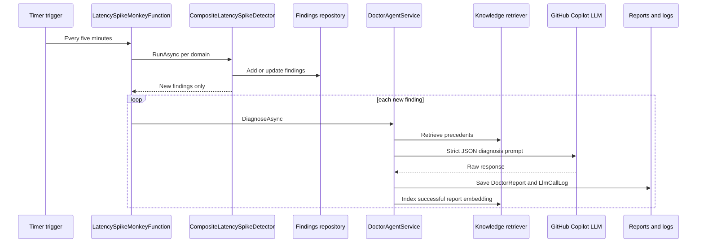

# Monitoring agents

JourneyMonitor includes two real Simian Army agents: **Latency Spike Monkey** detects slow stage clusters, and **Doctor Monkey** diagnoses new findings with deterministic classification, knowledge retrieval, and a guarded LLM call. Their timers, APIs, settings, and persistence run through the same Web/Functions/Core/Infrastructure architecture described in [Architecture overview](architecture.md), and the SQL detector can consume journey snapshots from [Data flows](data-flows.md).

## Runtime loop

`LatencySpikeMonkeyFunction` runs every five minutes for Cars, Hotels, and Cruises. Air is intentionally not wired because Air latency-spike KQL has not been authored. For every new finding the detector returns, the function immediately calls `DoctorAgentService.DiagnoseAsync` in the same invocation; there is no queue in the current MVP.

This sequence shows the synchronous detection-to-diagnosis loop used by the current MVP.

`GetMonkeysFunction` exposes real cards for `latency-spike-monkey` and `doctor-monkey`; `app.js` merges them with the remaining static mock roster. `GetFindingsFunction` exposes `/api/findings` and the on-demand `/api/findings/{id}/doctor-report` detail endpoint.

## Detector sources and rollout

`CompositeLatencySpikeDetector` is the registered `ILatencySpikeDetector`. It dispatches per domain to either:

- `LatencySpikeDetectorService`, the KQL-based detector that reads per-transaction latency-spike KQL from Application Insights; or
- `SqlLatencySpikeDetectorService`, the SQL snapshot detector that reads latest journeys from `IJourneyStore`.

`MonitoringOptions.SqlDetectorDomains` is the gradual rollout switch. Domains listed there use the SQL detector; unset means every domain stays on KQL. `MonitoringOptions.ShadowDomains` runs the inactive detector's `PreviewAsync` side-by-side and logs a comparison without repository side effects.

The SQL detector is not semantically identical to KQL. KQL counts individual slow requests in a rolling window. SQL counts distinct journeys last seen within the settings window whose stored stage `maxMs` or `stageTotalMs` crosses the threshold. Product notes under `docs/product/latency-spike-doctor-monkey-db-migration-plan-2026-09-21.md` record that this semantic change was accepted and validated live for Cars with shadow comparison.

## Finding evidence and classification

Both detectors create or refresh findings keyed by `domain:stage`, and `StaleFindingReconciler` resolves open findings that no longer qualify when a real detection pass succeeds.

Evidence shapes differ by detector:

| Detector | Evidence highlights | Classifier behavior |
|---|---|---|
| KQL detector | `statusCodeBreakdown`, `operationIds`, `correlationIds`, `observedCount`, `maxDurationMs` | `HeuristicErrorClassifier` maps all-2xx to `server_infrastructure`, 502/503/504 to `external_dependency`, 500 to `application_code`, 400/422 to `data_quality`, and 401/403 to `configuration`. |
| SQL detector | `source: "sql-journey-store"`, `healthStatusBreakdown`, `avgFailureRatePct`, `correlationIds`, and a note explaining snapshot semantics | The classifier only maps all `GREEN`/`N/A` to `server_infrastructure`; `RED`/`YELLOW` falls to `unknown` because health colors cannot distinguish HTTP failure classes honestly. |

Doctor Monkey passes raw `EvidenceJson` to the LLM prompt rather than assuming a fixed detector-specific shape.

## Doctor Monkey LLM safeguards

`DoctorAgentService` is intentionally defensive:

- It runs a deterministic heuristic classification before the LLM call.
- It retrieves up to five knowledge chunks and asks the LLM for strict JSON only.
- If the LLM is unavailable or returns invalid JSON, it saves an explicit `unknown` report with confidence `0` rather than inventing a diagnosis.
- It validates citation chunk ids and drops proposed fixes when no real citation supports them.
- It truncates overlong verdicts before SQL insert.
- It stores the parsed `DoctorReport`, then best-effort logs prompt/raw response in `LlmCallLog`; a log-write failure does not discard the report.
- When embeddings are available, it indexes saved report summaries, including explicit `unknown` fallbacks, back into the knowledge base for future precedent retrieval.

The LLM client is `GitHubCopilotLlmClient`. Tokens must be GitHub OAuth `gho_` tokens, not `ghp_` PATs.

## Persistence and settings

Monitoring uses SQL repositories when `JourneyStore:ConnectionString` is configured and the `monitoring.*` schema is provisioned; otherwise it falls back to in-memory repositories so local development still runs. `AddJourneyMonitorMonitoring` checks schema availability with `MonitoringSchemaGate` and logs a fallback warning instead of selecting broken SQL repositories.

The `monitoring` schema stores:

- `Finding`, `DoctorReport`, `KnowledgeChunk`, and `MonkeyRun` in `CreateMonitoringFindings.sql`.
- `LatencySpikeSetting` and append-only `LatencySpikeSettingAudit` in `CreateMonitoringSettings.sql`.
- encrypted Doctor Monkey client settings plus token-free audit history in `CreateMonitoringLlmClientSetting.sql`.
- prompt/raw-response `LlmCallLog` in `CreateMonitoringLlmCallLog.sql`.
- future action counters in `CreateMonitoringActions.sql`.

The Settings tab reads and writes latency thresholds and LLM client settings through Web proxy routes. Any portal user may change these settings by product decision, but writes are still protected operationally: Web adds `changedBy` from the authenticated identity when Entra is configured, validates antiforgery tokens in authenticated mode, and Functions require `X-Settings-Write-Secret`.

## Sensitive API gates

Functions are anonymous at the Azure Functions authorization level, so monitoring adds explicit shared-secret gates:

- `UpsertLatencySpikeSettingFunction` and `UpsertLlmClientSettingFunction` require `X-Settings-Write-Secret` and fail closed if `Monitoring:SettingsWriteSecret` is blank.
- `GetFindingDoctorReport` requires `X-Internal-Api-Secret` because it can expose full prompts and raw LLM responses.
- `ListLlmClientModelsFunction` also requires the internal secret because it tests a caller-supplied token against a live outbound Copilot API call.

These gates complement, but do not replace, the Managed Identity Web-to-Functions plan called out in [Architecture overview](architecture.md).

## Change guidance

- Keep `LatencySpikeMonkeyFunction` orchestration simple. Detector semantics belong in detector services, not the timer body.
- When altering detector evidence, update `HeuristicErrorClassifier` and tests so Doctor Monkey does not silently degrade to misleading classifications.
- Treat SQL detector counts as journey-snapshot counts, not request counts; preserve the evidence note unless the underlying SQL semantics change.
- Never log or document real LLM tokens. The GET settings response intentionally returns only `hasToken` and a masked suffix.
- Relevant tests live under `Portal/tests/JourneyMonitor.Tests/Monitoring` and `Portal/tests/JourneyMonitor.Tests/UseCases`.
